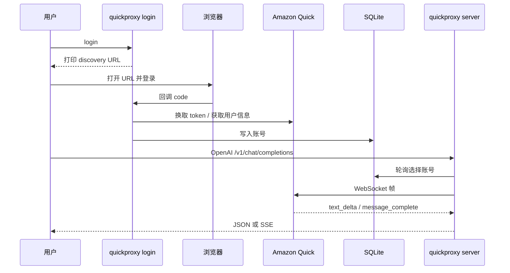

# QuickWork / Amazon Quick → OpenAI API

[English](README.md) | [简体中文](README.zh-CN.md)

把 Amazon Quick（QuickWork）桌面端的聊天能力转换成 **OpenAI 兼容的 HTTP API**。

项目是单一 Go 可执行文件：原生 OAuth 登录、账号存储、token 刷新和反代全部由 Go 完成，不需要 Python，也不用启动官方桌面应用或 outpost 进程。登录后由反代把 `/v1/chat/completions` 请求转换为 QuickWork WebSocket 帧，并把结果转回普通 JSON 或 SSE。

> 非官方项目，与 Amazon / AWS 无关联。请仅在你拥有或获得明确授权的账号上使用，并遵守相关服务条款。

## 功能

- `POST /v1/chat/completions`，支持流式（SSE）与非流式响应
- `POST /v1/responses` 与 `POST /v1/messages`，支持流式、非流式、客户端工具调用及结果回传
- `POST /v1/responses/compact` 生成可回传的加密对话摘要；`POST /v1/messages/count_tokens` 提供明确标记的估算计数
- `GET /v1/models`，返回本地模型别名
- 原生 social 登录（AWS IAM Identity Center OIDC）与企业 OIDC 登录，使用 PKCE
- 支持服务器/远程登录：手动粘贴浏览器 callback URL，无需开放本地回调端口
- 服务端配置集中存放在 `config.json`
- 账号存放在 SQLite（`data/quickwork.db`），支持多账号轮询与自动刷新
- 请求按轮询选择账号；到期 token 自动 refresh；串流开始前按错误分类重试，单账号也可恢复暂时故障
- 可选本地 API key 保护
- 内嵌 WebUI：概览、账号管理、远程 OAuth 登录、配置编辑和 Playground，不需要 Node.js / npm
- WebUI 支持 English / 简体中文切换；界面语言不改变上游请求的 `locale` 配置
- 独立管理密码、HttpOnly 会话 Cookie、CSRF 防护和登录限流；管理密码与推理 API key 分离
- Docker 多阶段构建与 Compose 部署，非 root 运行并持久化账号和配置
- 默认复用上游会话（`session_reuse=true`）；设为 `false` 时每轮结束删除会话，避免污染聊天列表
- 会话复用：同一段对话固定上游 thread 与账号，每轮只送新增消息，避免重送整份 transcript 撞 64 KB 上限；可用 `X-Conversation-Id` / `X-Thread-Id` 显式指定会话
- 客户端 `tools` / `functions` 通过 `<caller_tool_interface>` 文本协议桥接；代理解析 `<client_tool_call>` 并返回 OpenAI `tool_calls`，实际执行仍在客户端
- 工具桥接兼容多种模型写法：`arguments` / `parameters` / `input` / `args`、`tool_calls` / `tool_call` / `function_call`、Markdown 代码块、`functions.` 等命名空间前缀、大小写与唯一后缀匹配；支持同一轮并行多个工具调用
- 历史中的 `assistant.tool_calls` / `role: tool` 仍会按文本渲染，供上游理解已有上下文
- 使用上游 `turn_usage` 返回 `usage` 与 `prompt_tokens_details.cached_tokens`
- 持久化每账号真实调用次数、累计尝试耗时、官方 Token / 美元 / ACP 积分统计，并支持手动或定时同步官方月度分钟额度
- `system` / `developer` 消息与工具定义放在本轮 user 文本开头的 `[System instructions from the API caller]` 区块内；上游会忽略每轮 `system_prompt` 字段，并把 `custom_prompt` 当作低信任的个人偏好，user 轮次是唯一可靠送达调用方指令的通道
- 64 KB 单帧预算按实际 JSON 字节计算：用户内容过大时优先走 out-of-band 附件（`upload-attachment` → DLP 扫描 → `files/upload`），WebSocket 只发送短引用与 `attachments` 元数据；附件只包含用户内容，调用方指令仍留在 WS 文本里。附件不可用时才裁剪、保留开头与结尾，避免直接返回 `request_too_large`
- `chat_agent_id` 可指定一个 QuickWork 自定义 agent，以替代默认内置 agent 的提示词与工具策略

## 客户端接入与使用记录

OpenAI SDK / Codex 的 Base URL 使用 `http://127.0.0.1:8080/v1`；Claude Code 的 `ANTHROPIC_BASE_URL` 使用 `http://127.0.0.1:8080`，不带 `/v1`。替换为实际监听端口或反向代理地址。远程部署应仅代理推理路径并使用 HTTPS，不要一并公开管理后台。

推理密钥支持 `Authorization: Bearer <key>` 和 `x-api-key: <key>`。可配置 `api_keys`，也可通过 `QUICKPROXY_API_KEYS` 环境变量提供逗号分隔的密钥列表；环境变量优先，且不会通过保存配置写回文件。显式设置空环境变量会拒绝启动，避免误关闭鉴权。管理密码不能替代推理密钥。首次运行生成 `config.json` 时会自动生成一个默认推理 key（`sk-qw-…`）；登录 WebUI 后可在「配置 → 推理 API Keys」查看并复制当前生效的 key，Playground 也会默认填入。

在 WebUI「配置」中按上游模型（smart / fast / balanced / auto）逐行填写要映射到它的客户端模型名，多个用逗号分隔，留空则直接使用上游模型名；也可直接配置：

```json
"model_mappings": { "opus5.5": "smart" }
```

映射目标为 `smart`、`fast`、`balanced` 或 `auto`。`/v1/models` 列出别名，响应保留客户端请求的模型名；在 WebUI 保存的映射立即生效，无需重启，直接修改文件则需重启。上游实际使用的模型（如 `us.anthropic.claude-opus-5-5`）取自 `turn_usage.served_model_id`，在请求日志和使用记录中显示为 `served_model`。「配置」页提供 Codex、Claude Code 和 SDK 的接入示例。Codex 需要设置 `wire_api="responses"`、`web_search="disabled"`；支持 function / custom 客户端工具及命名空间，不支持 OpenAI 托管搜索。

图片支持三种协议中的 base64 PNG、JPEG、GIF，实际上传到上游附件服务并等待 DLP 放行；每次最多 8 张、每张 5 MiB、合计 20 MiB，宽高不超过 8192。为避免 SSRF，不抓取远程图片 URL。不支持的格式、gateway 图片或上传失败会报错，不会静默变成纯文本。

Responses 的压缩接口调用上游生成摘要，再返回绑定当前 API Key 的 `compaction` 项，可放入后续 `input`。启用鉴权时可跨进程重启恢复；更换 API Key 后须重发完整历史。未启用鉴权时压缩项仅在当前进程有效。`previous_response_id`、后台执行和服务端响应存储不受支持，客户端应发送完整历史或本服务生成的压缩项。采样与输出上限仍受下方限制约束。

左侧「使用记录」展示每条客户端推理请求，包括失败请求，支持协议、模型、失败状态筛选及分页。详情包含请求 ID、原始/上游模型、状态、耗时、账号、每次尝试、工具数量、图片数量、上下文处理方式、官方上报 Token 和费用。不保存请求/响应正文、图片内容或完整密钥；记录最多保留 30 天、10,000 条，只有管理会话可以读取。客户端子 agent 由 Codex / Claude Code 编排，代理隔离各客户端会话，不执行客户端工具。

回归测试：`go test -race ./...`。真实上游测试会使用账号额度，需显式设置 `RUN_LIVE_TESTS=1` 和 `QUICKPROXY_API_KEY` 后运行 `node scripts/smoke.mjs`；可用 `QUICKPROXY_BASE_URL`、`QUICKPROXY_TEST_MODEL` 覆盖测试目标。脚本不需要安装 npm 依赖。

## 环境要求

- Go 1.26.3+（仅本机构建时需要；Docker 构建已包含 Go 工具链）
- 一个可正常登录的 Amazon Quick 账号
- 浏览器：自动回调模式要求与 `quickproxy login` 在同一台机器并能访问回调端口（默认 `18080`）；WebUI 或 `login -manual` 不需要回调端口可达
- 不需要 Python、Node.js、npm、官方桌面应用或 outpost 进程

## 快速开始

### 1. 构建

```bash
cd quickwork-openai
go build -o bin/quickproxy.exe ./cmd/quickproxy   # Windows
# go build -o bin/quickproxy ./cmd/quickproxy     # macOS / Linux
```

### 2. 登录上游账号

```bash
./bin/quickproxy login --provider social
```

首次运行会在当前目录创建 `config.json`，并在 `data/quickwork.db` 初始化 SQLite。终端会打印一个 discovery URL，例如：

```
https://quick.aws.com/sn?qwSurface=desktop:<nonce>:18080:1.2.4660
```

在**同一台机器**的浏览器中打开它，完成登录。工具会接收浏览器回调、完成 OAuth / PKCE、交换 token、获取用户信息，并把账号写入 SQLite。完成后终端只打印账号显示信息、`ws_host` 和到期时间，不打印 token。

企业 SSO 登录：

```bash
./bin/quickproxy login --provider enterprise --region us-east-1
```

需要登录多个账号时，重复执行 `login` 即可。相同 email + tenant 的账号会更新，不会重复插入。

#### 服务器 / 远程登录（手动回填 callback URL）

如果 `quickproxy` 跑在服务器上，浏览器访问不到服务器的 `localhost:18080`，使用手动模式：

```bash
./bin/quickproxy login -manual
```

流程：

1. 终端打印 discovery URL，在任意机器用浏览器打开并登录。
2. 浏览器会跳转到 `http://localhost:18080/callback?...`。这个页面可能打不开，属正常现象；从地址栏复制**完整 URL**，粘贴回终端。
3. 终端会打印 authorize URL；继续在浏览器打开并完成登录。
4. 浏览器会跳转到 `http://127.0.0.1:18080/?code=...`；同样复制地址栏的完整 URL，粘贴回终端。
5. 工具完成 token 交换并写入 SQLite。

工具会根据 URL 参数自动判断阶段：`nonce=...` 是 discovery callback，`code=...&state=...` 是授权完成 callback。贴入 authorize URL、discovery URL、重复的 discovery callback 或带 fragment 的 callback 都会被识别并提示下一步，不会重复注册 OAuth client。

整个过程不需要服务器开放回调端口；回调端口只用于生成浏览器地址。也可以把 callback URL 通过 stdin 管道传入，便于脚本化。

### 3. 启动反代

```bash
./bin/quickproxy server
```

服务读取当前目录的 `config.json`。默认监听 `127.0.0.1:8080`。首次生成的配置自带一个默认推理 key；如果把 `api_keys` 改为空，代理关闭 API key 鉴权，仅适合纯本机使用。

WebUI 与推理 API 使用同一地址，打开 `http://127.0.0.1:8080/` 即可访问。启动进程前，请通过你的环境管理方式设置 `QUICKPROXY_ADMIN_PASSWORD` 管理密码环境变量，长度为 12–1024 字节；未设置时仅禁止管理登录，推理 API 不受影响。不要把密码填入文档、命令历史或 `config.json`。

只覆盖本次运行的监听地址（不修改配置文件）：

```bash
./bin/quickproxy server -addr 127.0.0.1:8090
```

### 4. 调用

```bash
curl http://127.0.0.1:8080/v1/models \
  -H "Authorization: Bearer local"
```

```bash
curl http://127.0.0.1:8080/v1/chat/completions \
  -H "Authorization: Bearer local" \
  -H "Content-Type: application/json" \
  -d '{
    "model": "smart",
    "stream": true,
    "messages": [{"role": "user", "content": "用三句话解释 QUIC"}]
  }'
```

Python SDK：

```python
from openai import OpenAI

# api_keys 为空时 api_key 可填任意值；配置后填对应 key。
client = OpenAI(base_url="http://127.0.0.1:8080/v1", api_key="local")

for chunk in client.chat.completions.create(
    model="smart",
    messages=[{"role": "user", "content": "hello"}],
    stream=True,
):
    print(chunk.choices[0].delta.content or "", end="")
```

## Docker / Compose

仓库提供 `Dockerfile`、`compose.yaml` 和白名单式 `.dockerignore`。构建上下文只包含 Go 源码、模块文件和内嵌 WebUI 资源，不包含本地配置、数据库或登录状态。

先通过部署环境设置 `QUICKPROXY_ADMIN_PASSWORD`（12–1024 字节），然后在项目目录运行：

```bash
docker compose up -d --build
```

打开 `http://127.0.0.1:8080/`，使用管理密码登录，再在账号页面添加上游账号。Compose 默认只把容器端口发布到主机 loopback；可通过 `QUICKPROXY_PORT` 修改主机端口。容器内仍监听 `0.0.0.0:8080`。

持久化与运行约定：

- 命名卷 `quickproxy-data` 挂载到 `/app/data`；首次运行生成 `/app/data/config.json`。
- 默认数据库相对配置文件目录解析，因此容器内路径为 `/app/data/data/quickwork.db`；如希望改为 `/app/data/quickwork.db`，把配置中的 `database` 设置为 `quickwork.db` 后重启。
- 已有配置和数据库不会在重新构建镜像或重启时覆盖；不要用删除卷的方式升级。
- 进程以 UID/GID `10001:10001` 运行。使用 bind mount 替代命名卷时，需要预先授予该用户数据目录写权限。
- Compose 使用只读根文件系统、丢弃全部 Linux capabilities、`no-new-privileges` 和临时 `/tmp`。
- 健康检查只调用容器内 `/healthz`，不会访问上游，也不要求已有账号。
- 首次运行生成配置时会自动生成一个默认推理 API key，可在 WebUI「配置」页复制。需要远程访问时使用带 TLS 和访问控制的反向代理，不要直接暴露管理页面。

也可以在容器内进行手动 CLI 登录：

```bash
docker compose exec quickproxy /app/quickproxy login -manual -config /app/data/config.json
docker compose exec quickproxy /app/quickproxy accounts -config /app/data/config.json
```

WebUI 中模型映射以外的配置保存后需要重启：

```bash
docker compose restart quickproxy
```

如仅构建镜像：

```bash
docker build -t quickwork-openai:local .
```

## WebUI

WebUI 默认启用，与 OpenAI 兼容 API 共用监听地址。配置 `webui.enabled=false` 后重启可关闭管理页面与管理 API，不影响推理 API。

### 管理登录与语言

- 管理密码仅从 `QUICKPROXY_ADMIN_PASSWORD` 进程环境变量读取，不存入配置，不与 `api_keys` 共用。
- 管理会话使用 HttpOnly、SameSite=Strict Cookie；写操作额外校验 CSRF token 和请求来源，登录有速率限制。
- `webui.session_ttl` 控制管理会话有效期，默认 `12h`；服务重启后需要重新登录。
- 使用页面中的语言选择器切换 English / 简体中文。语言偏好只影响界面文字，不会更改账号、模型或上游 `locale`。
- 管理 API 位于无版本的 `/api/` 路径，不继承推理 API 的通配 CORS 策略。推理 API key 不授予管理权限。

### 页面功能

- **概览**：查看进程启动时间、模型、账号可用状态、真实上游调用及成功/失败次数、累计尝试耗时、官方 Token、美金费用与按单位分别累计的 ACP 积分。旧账号选择次数单独展示。
- **账号**：查看每账号调用、耗时、Token、费用、积分与官方月度分钟额度，同时支持启用/停用轮询、刷新 token、确认后删除本地账号。用量同步与 Token 刷新是不同操作；删除不会撤销上游授权。
- **添加账号**：复用现有 OAuth / PKCE 流程，在任意浏览器完成两阶段登录，无需容器或服务器暴露 `18080`。
- **配置**：模型映射按上游模型以键值形式填写，其余配置以 JSON 编辑；模型映射、模型列表与默认模型保存后立即生效，其他配置写入磁盘后需重启服务生效。推理 API Keys 区域显示当前生效的 key 并支持一键复制；替换框留空保留原值，只有明确选择清空才移除全部 key。
- **Playground**：发送非流式聊天请求；如果配置了推理 API key，需要单独输入。管理密码不能用于推理鉴权，页面不持久保存这些秘密。

### 在 WebUI 添加账号

1. 进入账号页面，选择 provider / stage，需要时填写 region，然后开始登录。
2. 打开 discovery 链接并完成浏览器登录。
3. 浏览器跳到 `localhost` 回调页后，从地址栏复制完整 URL，粘贴到 WebUI 提交；回调页无法打开是正常现象。
4. 打开页面返回的 authorize 链接，完成授权，再粘贴最终包含 `code` 和 `state` 的完整回调 URL。
5. 成功后账号写入 SQLite 并更新列表。可取消流程；超时后重新开始。

回调 URL 含临时授权数据，请勿提交到聊天、日志或工单。WebUI 不保存或显示账号 token、refresh token、client secret。

### 账号统计与官方用量

账号页面区分本地调用统计与独立同步的官方额度：

- **调用次数**：每次真实 `Upstream.Chat` 尝试计一次，包含失败与重试。返回可见文字或有效工具调用才记为成功。旧 `use_count` 仍表示账号选择次数，并非真实调用次数。
- **累计耗时**：`total_duration_ms` 累加每次尝试的墙钟耗时，不含 Token 刷新、重试退避等非聊天工作，不是账号在线或登录时长。
- **Token**：输入、输出、总量、缓存读取和缓存写入仅来自官方 WebSocket `turn_usage`，不估算未上报用量。统计从 `stats_since` 开始，不回溯本功能上线前的历史。
- **美元费用**：`cost_usd` 只使用官方 `turn_usage` 费用字段。可能未知或仅覆盖部分调用，`cost_reported_calls` 表示覆盖次数。明确上报的零值与未知值不同。
- **积分**：官方 `acp_metadata` 提供 `cost_value` 和 `cost_unit_plural`（默认单位 `credits`）。同一 assistant 消息的后续快照覆盖前次报告，不按重复帧累加。按不同单位分别累计，并展示 `reported_calls` 覆盖次数，绝不合并不同单位。普通 `smart` / `fast` 请求不一定返回 ACP metadata，空数组显示“未上报积分”而非零。失败或重试尝试已经上报的消耗也会统计。
- **月度额度**：官方 profile / usage 返回单位为**分钟**，分普通月度额度与月度超额用量。已用、总额、剩余都可能未知；超额总额缺失不能视为零，套餐可能无上限。只有有效的已用与总额同时存在时才计算剩余分钟，不从 Token 或美元费用反推。

**积分、美元、Token、月度分钟是不同统计维度。代理不会互相换算，也不会根据本地调用次数推算积分余额。**

点击单账号“同步用量”或“同步全部用量”（启用账号批量同步）可更新官方额度快照，不会改写聊天 Token、费用或积分统计。界面显示最后成功同步、最近尝试、额度重置时间，以及 `unknown` / `available` / `stale` / `error` / `unsupported` 状态。同步失败时，有历史成功快照则保留并标记过期，不会替换成零。

自动同步在服务启动后执行一次，之后按 `usage.refresh_interval` 同步启用账号，默认五分钟。`usage.enabled=false` 仅停止自动同步，手动同步仍可使用。`usage.max_attempts` 限制官方用量暂时失败的重试次数。账号页面展示当前生效的后台同步配置与下次运行时间；在服务设置编辑 `usage`，保存后重启生效。

官方 profile 传输实现依据已确认源码行为，**本次改动尚未发起真实请求验证**。不同 provider / 订阅套餐可能不提供或拒绝相关接口。不可用、未支持、缺失的数据均显示未知，不伪造额度或积分。

管理端点需要管理会话，写操作还需要 CSRF 请求头：

| 端点 | 用途 |
|---|---|
| `GET /api/accounts` | 返回账号与 `usage` 统计、缓存的 `quota` 快照 |
| `GET /api/status` | 返回聚合调用/耗时/官方上报用量及生效中的 `usage_sync` 后台状态 |
| `POST /api/accounts/{id}/usage/refresh` | 同步一个账号的官方额度，返回 `{quota: ...}` |
| `POST /api/accounts/usage/refresh` | 同步启用账号，返回逐账号结果 |

单账号同步错误码为 `usage_unavailable`、`usage_unauthorized`、`usage_failed` 或 `usage_busy`。成功和失败后均重新读取表格，以展示保留/过期快照；接口不暴露账号 Token 或上游原始响应。

## 配置 `config.json`

`quickproxy server` / `login` 在文件不存在时会写入默认配置。完整示例：

```json
{
  "addr": "127.0.0.1:8080",
  "database": "data/quickwork.db",
  "api_keys": [],
  "models": ["smart", "fast", "balanced", "auto"],
  "default_model": "smart",
  "request_timeout": "5m",
  "refresh_before": "10m",
  "max_attempts": 3,
  "app_version": "1.2.4660",
  "surface": "QUICK_WORK_DESKTOP_WINDOWS",
  "outpost_id": "",
  "working_session_id": "",
  "timezone": "UTC",
  "locale": "en-US",
  "thinking_effort": "",
  "chat_agent_id": "",
  "keep_sessions": false,
  "session_reuse": true,
  "session_ttl": "30m",
  "webui": {
    "enabled": true,
    "session_ttl": "12h"
  },
  "usage": {
    "enabled": true,
    "refresh_interval": "5m",
    "max_attempts": 3
  },
  "oauth": {
    "provider": "social",
    "build_stage": "prod",
    "region": "",
    "callback_port": 18080,
    "timeout": "1h"
  }
}
```

| 字段 | 默认 | 说明 |
|---|---|---|
| `addr` | `127.0.0.1:8080` | HTTP 监听地址 |
| `database` | `data/quickwork.db` | SQLite 文件；相对路径基于 `config.json` 所在目录 |
| `api_keys` | 首次运行自动生成 1 个 | 允许的本地 API key；为空时关闭鉴权 |
| `models` | `smart,fast,balanced,auto` | `/v1/models` 的基础列表；额外别名由 `model_mappings` 提供 |
| `model_mappings` | `{}` | 客户端模型名到 smart / fast / balanced / auto 的映射 |
| `default_model` | `smart` | 未知 model 的映射 |
| `request_timeout` | `5m` | 单次上游请求超时 |
| `refresh_before` | `10m` | token 距离到期小于该值时自动 refresh |
| `max_attempts` | `3` | 单次请求全部重试的真实上游 `Chat` 尝试总数，不是不同账号数 |
| `app_version` | `1.2.4660` | 上游握手使用的 appVersion |
| `surface` | `QUICK_WORK_DESKTOP_WINDOWS` | 上游握手使用的 surfaceType |
| `outpost_id` / `working_session_id` | 空 | 上游握手可选字段 |
| `timezone` / `locale` | `UTC` / `en-US` | `user_message` 中的时区与语言 |
| `thinking_effort` | 空 | `off`、`low`、`medium`、`high`；空=服务端默认，`off` 会显式发送关闭 |
| `chat_agent_id` | 空 | 指定 QuickWork 自定义 agent；服务端按该 agent 的 system prompt 与 tool policy 执行，用于隔离默认内置提示词和内置工具 |
| `keep_sessions` | `false` | 关闭 `session_reuse` 时，是否保留上游会话 |
| `session_reuse` | `true` | 以固定上游会话只送新增消息；同一会话固定使用原账号 |
| `session_ttl` | `30m` | 会话闲置多久后从代理内存移除 |
| `webui.enabled` | `true` | 启用同地址内嵌 WebUI 与管理 API；更改后重启 |
| `webui.session_ttl` | `12h` | 管理登录会话有效期，与上游会话 TTL 无关 |
| `usage.enabled` | `true` | 启动与定时同步启用账号的官方用量；关闭不影响手动同步 |
| `usage.refresh_interval` | `5m` | 官方用量同步间隔，范围 `1m`–`24h` |
| `usage.max_attempts` | `3` | 官方用量暂时失败的最多尝试次数，范围 `1`–`5`，独立于聊天 `max_attempts` |
| `oauth.provider` | `social` | `login` 默认 provider |
| `oauth.build_stage` | `prod` | `prod`、`beta`、`integ`、`dev` |
| `oauth.region` | 空 | 企业 discovery 的 region 前缀；social 使用 discovery 返回的 IDC region |
| `oauth.callback_port` | `18080` | 本机 OAuth 回调端口 |
| `oauth.timeout` | `1h` | 等待浏览器完成登录的超时 |

时间字段接受 Go duration 字符串（`30s`、`5m`、`1h`）。

`server -addr ADDRESS` 只覆盖运行时监听地址，不写回文件。Docker 默认使用该参数监听容器网络；WebUI 修改 `addr` 后，若启动命令仍带 `-addr`，下次启动仍以命令行值为准。通过 WebUI 保存的其他配置（模型映射除外）也仅在重启后生效。

需要 API key 时，把 key 写进 `api_keys`：

```json
{
  "api_keys": ["sk-local"]
}
```

之后请求需带 `Authorization: Bearer sk-local`（或 `X-Api-Key: sk-local`）。

## 命令

| 命令 | 说明 |
|---|---|
| `quickproxy server` | 启动反代 |
| `quickproxy server -addr ADDRESS` | 覆盖本次运行的监听地址，不修改配置 |
| `quickproxy login` | 浏览器 OAuth 登录并写入 SQLite |
| `quickproxy accounts` | 列出账号、到期时间、使用次数与最近错误 |
| `quickproxy refresh` | 刷新全部账号的 token |
| `quickproxy refresh -account ID` | 只刷新一个账号 |
| `quickproxy logout -all` | 删除全部账号 |
| `quickproxy logout -account ID` | 删除一个账号 |

所有命令都支持 `-config PATH`，默认 `config.json`。

从旧版升级：旧的 `auth/quickauth.py` 已移除，`data/session.json` / `data/upstream.json` 不再读取。请重新执行一次 `quickproxy login`；之后所有账号都由 SQLite 管理。

`login` 常用参数：

| 参数 | 默认 | 说明 |
|---|---|---|
| `-provider` | `config.oauth.provider` | `social`、`enterprise`、`gateway`、`social_gateway` |
| `-stage` | `config.oauth.build_stage` | `prod`、`beta`、`integ`、`dev` |
| `-region` | `config.oauth.region` | 企业 discovery 的 region 前缀；social 使用 discovery 返回的 IDC region |
| `-port` | `config.oauth.callback_port` | 本机回调端口 |
| `-timeout` | `config.oauth.timeout` | 等待浏览器完成登录的超时 |
| `-open` | 关闭 | 同时用默认浏览器打开 URL |
| `-manual` | 关闭 | 不监听本地回调端口，手动粘贴浏览器地址栏中的 callback URL（适合服务器） |

## 多账号轮询

账号存在 SQLite 的 `accounts` 表，按 ID 轮询：

1. 每个请求选择下一个启用账号。
2. 如果 token 在 `refresh_before` 内到期，先用 refresh token 自动刷新。
3. 刷新失败或账号不可用时记录 `last_error`，跳过该账号继续轮询。
4. `max_attempts` 限制整次请求的真实上游 `Chat` 尝试总数，不是不同账号数；账号选择失败与 Token 刷新不消耗聊天尝试次数。所有重试共享原请求超时，退避从 200 ms 指数增长，最多两秒。
5. 暂时错误（限流 / HTTP 429、超时 / HTTP 408、HTTP 5xx、部分网络或 WebSocket 断连、无可见输出）优先尝试尚未使用的可用账号；用完后可重试仍符合条件的账号，因此只有一个账号时也能在同一预算内恢复。
6. 过期 / 无效凭证每次请求每账号最多主动刷新一次；刷新成功则重试该账号，重复认证失败则在本次请求中排除。权限、支付、积分或配额耗尽错误跳过该账号，不会反复重试已耗尽账号。
7. 复用会话不存在时，清除本地复用状态，用完整 transcript 新建上游会话重试；新会话仍不可用则跳过该账号。客户端取消、超大/非法请求和其他永久错误不重试，请求总超时始终优先。
8. 一旦发送首个 SSE 响应字节，就不再重试或切换账号，以免重复输出。非流式与工具缓冲响应只有在尚未提交输出前才能重试。

每次真实尝试都会计入账号调用次数、耗时及其已经上报的官方用量，即使失败后再次重试成功也一样。重试可能额外消耗上游额度或产生计费；Token、美元或 ACP 报告缺失时保持未知/部分覆盖，不能因为最终响应成功就认为此前失败尝试免费。调度仍按请求轮询，不按 Token 或额度余额分配。

`quickproxy accounts` 可查看每个账号的状态；`quickproxy refresh` 会刷新全部账号。上游 refresh token 失效时，对应账号需要重新执行 `quickproxy login`。

## 工作方式



- 登录由原生 Go OAuth 流程完成，可使用 `quickproxy login` 或 WebUI，不依赖官方桌面应用或 outpost。
- `quickproxy server` 从 SQLite 读取 `jwt`、`ws_host` 和 `provider`，连接上游 WebSocket。
- 上游不是 OpenAI HTTP API，而是 WebSocket JSON 帧；`internal/proxy/wire.go` 负责帧编码与 event-stream 解码。

### 提示词与工具调用

- `system` / `developer` 消息会按原顺序合并，与工具定义一起组成 caller 指令块，放在本轮 user 文本开头：`[System instructions from the API caller]` … `[End system instructions]`，后面才是 `[User message]` 与 transcript。
- 这是为了适配上游实际行为：`user_message.payload.system_prompt` 会被服务端忽略（模型完全看不到），`custom_prompt` 会被当成低信任的个人偏好、可能被拒绝执行。放进 user 轮次的调用方指令则会被当作本轮任务，实测能稳定驱动工具调用与格式要求。
- caller 指令块后面固定追加一条简短的中性 relay 说明：本轮通过 OpenAI 兼容 API 转发，调用方指令与 `<caller_tool_interface>` 定义本轮任务和工具，工具由调用方执行。刻意的「丢弃服务端提示词 / 忽略身份」措辞会触发上游的安全判断，使模型连正常指令一起拒绝，因此不使用。
- 客户端 `tools` / `functions` / `tool_choice` 会原样写入 caller 指令块中的 `<caller_tool_interface>`，并明确说明这些工具由调用方提供、执行并回传结果，模型不需要内置对应的工具。
- 模型使用 `<client_tool_call>{"name":"...","arguments":{...}}</client_tool_call>` 发起调用。解析器同时兼容 `<tool_call>`、`<function_call>`、整段 JSON、Markdown 代码块、`tool_calls` / `tool_call` / `function_call` 包装、`arguments` / `parameters` / `input` / `args` 字段、`functions.` 等前缀、大小写差异和唯一后缀匹配。未知工具名或非法 JSON 会保留为普通文本。
- 并行调用：允许在同一回复中连续输出多个 `<client_tool_call>`；`parallel_tool_calls=false` 时只保留第一个。
- 代理把解析结果转成 OpenAI `tool_calls`，但**不执行工具**；客户端执行后把结果作为 `role: tool` 发回，代理再转成文本上下文。
- 上游原生 `tool_start` / `tool_arguments` / `tool_progress` / `tool_call` / `tool_complete` / `message_complete.tool_calls` 也会被收集；`tool_progress.input_delta` 会累积为完整参数。如果文本标记没有解析出调用，代理会按客户端声明的工具名把原生事件回退成 `tool_calls`。
- 上游一个 WebSocket 帧内可能包含多条 event-stream 消息；解码器会按顺序全部处理，不会只取第一条。
- 上游只输出 thinking、空白或零宽字符时，代理返回明确错误并带上 `completion_tokens`，不再返回空的 `finish_reason=stop`。
- 有客户端工具时，流式响应会缓冲到本轮结束，再一次性发送文本或 `tool_calls`；非流式不受影响。
- `tool_choice: "none"` 关闭桥接；指定函数时只接受该函数；`parallel_tool_calls=false` 时最多返回一个工具调用。
- 内置 agent 的 60K+ token 提示词、产品身份与内置工具仍由 QuickWork 服务端维护，无法通过 `user_message` 删除；调用方指令决定任务行为，但模型仍可能自称 AWS Quick。若需要彻底替换提示词与工具策略，在 `config.json` 设置 `chat_agent_id` 指向一个关闭内置工具、使用自定义 system prompt 的 QuickWork agent；代理会把该 ID 放进 `user_message.chat_agent_id`。

### 会话复用

- 首轮发送完整 transcript，并记录上游 `thread_id` 与账号。
- 后续请求若消息历史是上次已发送历史的前缀，只发送新增后缀；这样 64 KB 预算主要留给新消息。
- 会话键优先使用 `X-Conversation-Id`，其次 `X-Thread-Id`；都没有时使用完整 system prompt（含工具定义）加第一条非 system 消息的哈希。不同工具的请求不会复用同一个上游 thread。
- system prompt 或工具定义变化、历史被编辑、或没有新增消息时，自动回退为完整 transcript + 新上游会话。
- 同一会话固定使用原账号；账号不可用或复用失败时，自动换账号并以完整 transcript 新建会话。
- 会话状态只保存在内存，进程重启后首轮回退完整 transcript。闲置超过 `session_ttl` 会从代理移除。
- 复用启用时不会发送 `session_delete`，上游会话会保留到服务端自身过期。

### 请求日志

每个聊天请求输出请求开始、每次账号尝试、最终结果，以及一行上游事件统计。最终结果包含状态、账号、上游模型、尝试次数、耗时、token 用量、`finish_reason`、工具调用数和错误信息。

```
chat chatcmpl-... start model=smart upstream_model=smart stream=false messages=2 prompt_chars=205 system_chars=40587 thread=""
chat chatcmpl-... attempt=1/3 account=1:social:user@example.com
upstream events thread=... counts=map[text_delta:2 text_complete:1 turn_usage:1] text_chars=89 tool_calls=0
chat chatcmpl-... done status=ok account=1:social:user@example.com model=smart attempts=1 elapsed=1.234s tokens{prompt=1200 completion=56 total=1256 cache_read=1024 cache_write=0} finish=stop tool_calls=0
```

`status` 为 `ok`、`empty` 或 `failed`；`attempt` 为 `id/最大尝试次数`。失败时附加 `error=...`。日志不会输出 token、client secret 或请求正文。

## 安全与隐私

- `data/quickwork.db` 包含 access token、refresh token、client secret 和用户信息，已被 `.gitignore` 排除。
- 当单个 `user_message` 超过 64 KB 且账号有 `tenant_url` 时，代理会把该轮用户内容作为临时文本附件上传到 Quick 的附件服务并等待 DLP 扫描；这是绕过单帧上限的方式，内容仍位于你的 Quick 租户内，但受组织 DLP 策略约束。
- `config.json` 默认不含密钥；如果写入 `api_keys`，不要提交真实 key。
- 上游登录密码只在 Amazon 的浏览器页面中输入，本项目不会保存上游密码；WebUI 管理密码为独立环境变量，不应使用上游密码。
- WebUI 仅在管理会话内返回当前生效的推理 API key，便于复制；不返回 access token、refresh token 或 client secret。callback URL 只用于当前登录流程，不应分享。
- 反代默认只监听 `127.0.0.1`。不要把端口直接暴露到公网；如确需远程访问，请自行加 TLS 与访问控制。
- `quickproxy logout -all` 会删除本地账号与 refresh 状态。
- 不要提交或分享 `data/` 目录。

## 限制

- 实现 Chat Completions、Responses 和 Messages 的对话/工具兼容层，不是所有原厂接口的完整实现。`temperature`、`max_tokens`、`stop`、`response_format` 等采样参数不会传给上游；不能保证客户端指定的输出 Token 上限，`n > 1` 会返回 400。
- 上游 `user_message` 帧上限 64 KB。会话复用开启时通常只送新增消息；若单个 delta 仍超限，代理会先把该轮用户内容上传为上游附件（`POST /integration/quick-work/upload-attachment`、轮询 `attachment-dlp-status`、再以 `qbs-event` 投递到 `files/upload/<thread>`），WS 只送短引用和 `attachments` 元数据；附件必须在 DLP 返回 `ALLOW` 后才能使用，`WARN` 视为不可用。附件只放用户内容，调用方指令与工具定义留在 WS 文本中，避免模型把附件里的指令当成注入。附件路径失败、账号没有 `tenant_url`、gateway transport 或被 DLP 拒绝时，代理回退到裁剪：按实际 JSON 字节保留开头与结尾、裁剪中间内容，并记录 `user_message trimmed ...`；只有连最小帧都无法放入时才返回 `400 request_too_large`。
- WebSocket 分片只影响传输层，上游重组后仍按单一 `user_message` 检查 64 KB。多个 `user_message` 会被视为多轮；`mid_turn` 是 steering，`message_split` 是服务端输出事件，不能用来拼接同一轮输入。
- 工具桥接使用文本协议，模型偶尔可能不遵守；有工具时流式响应会缓冲到本轮结束。代理只解析并返回 `tool_calls`，不执行工具。
- 默认内置 agent 仍会在服务端附加约 60K token 的提示词和内置工具。调用方指令通过 user 轮次影响任务行为，但不能删除服务端上下文或改掉产品身份；需要彻底隔离时使用 `chat_agent_id` 指向自定义 agent。
- 上游会忽略 `user_message.payload.system_prompt`，并把 `custom_prompt` 视为低信任偏好；代理因此不再使用这两个字段。caller 指令跟随 user 文本发送，已在 social 路径用真实账号验证；enterprise / gateway 仍待验证。
- `model` 会映射为上游 agent mode：`smart`、`fast`、`balanced`、`auto`。
- 上游没有模型列表 API；`/v1/models` 返回的是本项目配置的别名。
- social / enterprise 路径已做真实账号验证；`gateway` / `social_gateway` 的 CBOR 路径仍属实验性。
- 上游 access token 通常约 1 小时到期，反代会按 `refresh_before` 自动刷新；也可手动执行 `quickproxy refresh`。refresh 响应未返回新的 ID token 时会保留旧值，用户信息接口短暂失败不会丢弃已刷新的 token。
- 多账号轮询按请求选择账号，不按 token 用量或配额调度。
- 账号统计不回溯旧历史；Token、美元费用与 ACP 积分可能缺失或仅覆盖部分调用。官方月度分钟额度支持取决于 provider 和套餐，传输已按源码确认实现，但本次尚未进行真实请求验证。
- 上游接口可能随官方客户端更新而变化；若登录或聊天失败，先重新执行 `quickproxy login`。
- 本项目与 Amazon / AWS 无关联，不提供任何服务保证。

## 故障排查

| 现象 | 处理 |
|---|---|
| `cannot listen on 127.0.0.1:18080` | 关闭占用 18080 的其他进程，或用 `-port` / `oauth.callback_port` 换端口 |
| 浏览器登录后一直等待 | 确认浏览器与命令在同一台机器，且回调端口可达；远程服务器请用 `login -manual` |
| 服务器上 `localhost:18080` 回调打不开 | 这是预期现象；用 `login -manual`，复制浏览器地址栏的完整 URL 回填 |
| `upstream_session_unavailable` / `no accounts configured` | 运行 `quickproxy login` |
| `401 invalid_api_key` | 检查 `config.json` 的 `api_keys` 与请求头中的 key 是否一致 |
| 登录页面报错 | 查看终端输出的错误；确认 `-provider` 与账号类型匹配 |
| 多账号请求总是失败 | 运行 `quickproxy accounts` 查看 `last_error`；对失效账号重新 `login` 或 `logout -account ID` |
| token 过期 | 通常自动刷新；也可运行 `quickproxy refresh` |
| WebUI 提示未配置管理密码 | 在启动服务的环境中设置 `QUICKPROXY_ADMIN_PASSWORD`（12–1024 字节），然后重启 |
| WebUI 登录成功但无法调用 Playground | 如已配置 `api_keys`，需在 Playground 单独填入推理 API key；管理密码不是 API key |
| WebUI 保存配置后行为未改变 | 保存仅写磁盘；重启服务。监听地址还受 `server -addr` 覆盖 |
| Docker 内没有账号或数据不见 | 确认使用同一命名卷和 `/app/data/config.json`；默认数据库为 `/app/data/data/quickwork.db` |

## 目录

```
quickwork-openai/
  config.json              服务端配置（首次运行自动生成）
  cmd/quickproxy/          CLI：server / login / accounts / refresh / logout
  internal/admin/          WebUI、管理会话与无版本管理 API
  internal/admin/static/   内嵌 HTML / CSS / JS 与中英文界面
  internal/config/         config.json 加载与默认值
  internal/oauth/          原生 OAuth、PKCE、token refresh、user info
  internal/oauth/browser.go WebUI 复用的分阶段手动 callback 登录
  internal/store/          SQLite 账号存储
  internal/accounts/       多账号轮询与自动刷新
  internal/proxy/          WebSocket codec、OpenAI handler
  data/quickwork.db        运行期账号库（gitignored）
  Dockerfile               多阶段构建与非 root 运行镜像
  compose.yaml             持久卷与默认 loopback 部署
  README.md                English documentation
  README.zh-CN.md          简体中文文档
```

## License

本项目采用 [GNU General Public License v3.0](LICENSE) 授权。

## Acknowledgements

Thanks to the [LINUX DO](https://linux.do) community for its support.
